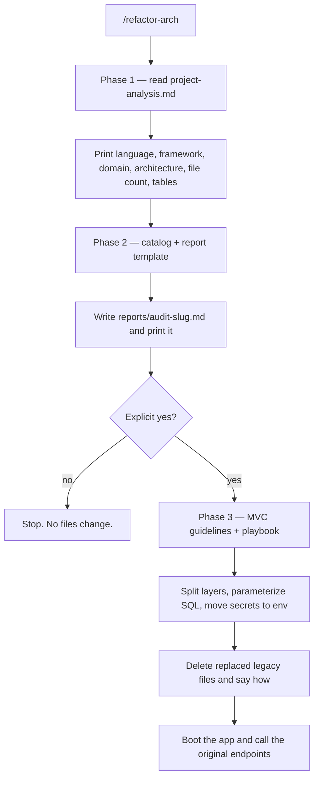

# refactor-arch — audit a legacy API, then refactor it to MVC

[Versão em português](README.pt-BR.md) · original submission write-up, including the manual boot notes.

**Adayane Coutinho** · built for an AI Engineering MBA challenge ([Skill de Auditoria e Refatoração Arquitetural](https://github.com/devfullcycle/mba-ia-refactor-projects-skill), Pós em IA).

`refactor-arch` is a [Claude Code](https://docs.claude.com/en/docs/claude-code) skill that audits an API codebase for architectural and security anti-patterns, writes a severity-ranked report with file and line citations, and — only after an explicit yes — refactors the project into MVC. The same skill folder, copied unchanged, was run on three course starter apps: two Python/Flask services at very different levels of organization, and one Node.js/Express service.

This repository is the delivery: the skill, the three refactored apps, and the three audit reports the skill wrote.

## The problem

Legacy APIs accumulate security bugs and structural debt in the same files: SQL built by string concatenation, secrets in source, god classes that own the schema, the routes, and the payment rule, and “organized” folders that still hide a forgeable login token. A one-shot prompt that both lists the problems and rewrites the code tends to skip the pause, invent findings, or leave the old file next to the new one.

The challenge was to encode that work as a reusable skill: detect the stack without assuming Python, cite every finding at `file:line`, stop for confirmation, then refactor while keeping the public API unless a finding *is* the contract (an endpoint whose only job is to run client-supplied SQL).

The three starters were provided by the course. They were not written for this portfolio. What this repo adds is the skill, the audits, and the refactors.

| Project | What it is | Shape before the refactor |
|---|---|---|
| [`code-smells-project`](code-smells-project/) | Flask e-commerce (`flask==3.1.1`) | Four root files. Queries concatenated in `models.py`. `POST /admin/query` executed SQL from the request body. `SECRET_KEY` was hardcoded and returned by `/health`. |
| [`ecommerce-api-legacy`](ecommerce-api-legacy/) | Express course platform with checkout (`express ^4.18.2`) | One `AppManager` class held the schema, the routes, and the payment rule, on callback-style `sqlite3`. A payment-gateway key with a `pk_live_` prefix lived in source, and checkout logged the full card number next to that key. |
| [`task-manager-api`](task-manager-api/) | Flask task manager (`flask==3.0.0`, Flask-SQLAlchemy) | Already had `models/`, `routes/`, `services/`, and `utils/`. Passwords used MD5, `GET` responses included the hash, and login returned `'fake-jwt-token-' + str(user.id)`. |

## What the skill does

Invoked as `/refactor-arch` (also when someone asks to audit architecture, find code smells, or move a legacy API to MVC), the agent:

1. Identifies language, framework version, relevant libraries, database tables, business domain, and current architecture. It prints a Phase 1 summary and is told not to invent dependencies or tables.
2. Walks the source against a catalog of 12 anti-patterns, including a required pass for deprecated APIs, and writes a report ordered CRITICAL → HIGH → MEDIUM → LOW. Every finding has a file, an exact line or range, an impact, and a recommendation that points at a playbook pattern.
3. Stops and asks `Proceed with refactoring (Phase 3)? [y/n]`. Anything other than a clear yes ends the run with no edits.
4. On confirmation, rebuilds the app into Config, Models, Routes, Controllers, and Middlewares, deletes legacy files that were fully replaced, boots the app, and hits the original endpoints.

The public HTTP contract stays (same routes, methods, and payload shapes) unless the audit shows the behavior itself is the vulnerability. In this repo that happened twice, and both breaks are written down in code comments and in the reports: `POST /admin/query` was removed from the e-commerce API, and the task manager’s login token is now a signed `itsdangerous` token.

## How it works

The skill is a short runbook plus reference files. `SKILL.md` tells the agent *when* to read each file. The domain knowledge stays in `references/`, so it can be reviewed on its own.

```
.claude/skills/refactor-arch/
├── SKILL.md
└── references/
    ├── project-analysis.md         # stack detection from manifests and imports
    ├── anti-patterns-catalog.md    # 12 anti-patterns, with detection signals
    ├── audit-report-template.md    # exact Phase 2 report shape
    ├── mvc-architecture-guidelines.md
    └── refactoring-playbook.md     # 12 before/after transformations
```

The three copies (under each app) are identical.



Phase 1 detection is a table of manifest files (`requirements.txt`, `package.json`, `go.mod`, `pom.xml`, `Gemfile`, `composer.json`, `*.csproj`, and others) plus import patterns. The catalog describes signals such as “query built by concatenating request input” and “`hashlib.md5` used on a password”, with examples in more than one syntax where it matters. The playbook’s before/after samples are Python/Flask and JavaScript/Express, matching the two stacks in the starters, and each pattern says which anti-pattern it addresses.

The target layout is five layers, named idiomatically (`snake_case` and Flask blueprints, or `camelCase` and Express routers):

| Layer | Responsibility in this repo |
|---|---|
| Config | Environment variables only. Dev defaults are placeholders (`dev-only-change-me`, `pk_test_dev_placeholder`), not live secrets. |
| Models | One module or class per entity. SQL with user input uses placeholders. |
| Routes | URL → controller. No business rules. |
| Controllers | Request flow. A service exists only where the rule is large enough (checkout, auth, notifications in the task manager). |
| Middlewares | One error handler that turns exceptions into a consistent HTTP error. |
| Entry point | Composition root only: `app.py` or `src/server.js`. |

Phase 3 step 5 treats leftover legacy files as a failed refactor. If the environment cannot `rm` a file, the agent must `git rm` it and report that in the Phase 3 summary. That step was tightened after the first delivery of this repo still contained `ecommerce-api-legacy/src/AppManager.js` and `src/utils.js` (the hardcoded `pk_live_` key and the card-number log). Those files are gone in the current tree; the follow-up commit is `fix: remove legacy AppManager.js/utils.js flagged in feedback`.

## What the audits found

The numbers below are the counts written in the saved reports. They are not a new measurement.

| Report | Stack recorded in the report | Files | Findings |
|---|---|---|---|
| [`reports/audit-project-1.md`](reports/audit-project-1.md) | Python + Flask | 4 (~688 lines) | 5 CRITICAL, 3 HIGH, 4 MEDIUM, 3 LOW (15) |
| [`reports/audit-project-2.md`](reports/audit-project-2.md) | Node.js + Express | 3 (~165 lines) | 4 CRITICAL, 3 HIGH, 3 MEDIUM, 2 LOW (12) |
| [`reports/audit-project-3.md`](reports/audit-project-3.md) | Python + Flask + Flask-SQLAlchemy | 15 (~520 lines) | 5 CRITICAL, 3 HIGH, 3 MEDIUM, 2 LOW (13) |

Each report follows `references/audit-report-template.md`: Phase 1 summary, then findings ordered by severity with `file:line`, impact, and a playbook reference.

The refactored trees all live under `src/` with `config`, `models`, `routes`, `controllers`, and `middlewares`. The task manager and the course API also keep `services/` (and `utils/` where a helper was already there). Concrete changes that are visible in the current code:

- **E-commerce API.** Parameterized SQLite queries. `SECRET_KEY`, `DEBUG`, database path, host, and port come from the environment in `src/config/settings.py`. `/health` returns status and row counts, and does not return the secret. `POST /admin/query` is gone; `POST /admin/reset-db` remains. Product create/update share `_validar_payload`. Discount thresholds are named constants on `Config`. Order line items are loaded with a `JOIN` instead of a query per item. User passwords are still stored and compared as plaintext, and list/get user responses still include `senha` — `src/models/usuario_model.py` says this was kept so the seeded data contract stayed the same. The audit’s recommendation was `werkzeug.security` hashing. See [Known gaps](#known-gaps).
- **Course API.** Checkout is `async/await` over `node:sqlite` (`DatabaseSync`), which replaced the callback `sqlite3` driver. `package.json` sets `"node": ">=22.5.0"`. `src/config/database.js` documents the swap: `sqlite3` needed a native `node-gyp` build that failed in the sandbox where this was built, and Node older than 22.5 can use `better-sqlite3` behind the same `run` / `get` / `all` helpers. Passwords go through `bcryptjs`. Gateway and SMTP settings are read from the environment (`.env.example`). Checkout no longer logs the card number or the gateway key. `DELETE /api/users/:id` still leaves enrollments and payments in place; `userController.js` says the original response contract was preserved.
- **Task manager.** `User.set_password` uses `werkzeug.security.generate_password_hash`. `User.to_dict` omits `password`. Login issues a `URLSafeTimedSerializer` token in `src/services/auth_service.py` (24-hour max age). Controllers call `Task.is_overdue()` and `process_task_data()`, both of which existed in the starter and were unused. Lookups in the controllers use `db.session.get(...)`. SMTP settings are environment variables (`.env.example`).

`code-smells-project` and `task-manager-api` still call `CORS(app)` with no origin list. Both audits flagged that as MEDIUM.

## Example output

Phase 1 of [`reports/audit-project-1.md`](reports/audit-project-1.md), the report the skill wrote for the e-commerce API:

```
================================
PHASE 1: PROJECT ANALYSIS
================================
Language:      Python
Framework:     Flask 3.1.1
Dependencies:  flask-cors 5.0.1
Domain:        E-commerce API (produtos, usuários, pedidos, relatório de vendas)
Architecture:  Monolítica — toda a aplicação em 4 arquivos (app.py, controllers.py, models.py,
               database.py), sem separação de camadas Model/View/Controller
Source files:  4 files analyzed
DB tables:     produtos, usuarios, pedidos, itens_pedido
================================
```

The same file then lists 15 findings. This is the one that forced a contract change (the endpoint is not in the refactored app):

```
[CRITICAL] SQL Injection / Execução de Query Arbitrária
File: app.py:59-78
Description: O endpoint `/admin/query` recebe uma string SQL diretamente do corpo da
             requisição (`dados.get("sql", "")`) e a executa sem nenhuma validação, sanitização
             ou allowlist.
Impact: É, por definição, uma porta aberta para execução de qualquer comando SQL (leitura,
        escrita ou destruição de dados) por qualquer cliente não autenticado.
Recommendation: Remover o endpoint. Não existe forma de "corrigir" esse contrato mantendo a
                funcionalidade original — a funcionalidade em si é a vulnerabilidade.
```

The reports are in Portuguese, which is the language of the challenge write-up. After printing the report, the skill asks whether to continue. The original submission records that refactoring started only after that confirmation.

The original write-up also records manual boots after the refactor (process start lines and `curl` status codes for each app). Those notes live in [README.pt-BR.md](README.pt-BR.md), section “Logs de validação”. This README does not repeat them as new results. Sample requests for the course API are in [`ecommerce-api-legacy/api.http`](ecommerce-api-legacy/api.http).

## Install and run

### Run the skill

[Claude Code](https://docs.claude.com/en/docs/claude-code) needs to be installed and authenticated. The skill is already inside each project, so Claude Code discovers it from that directory:

```bash
cd code-smells-project
claude "/refactor-arch"

cd ../ecommerce-api-legacy
claude "/refactor-arch"

cd ../task-manager-api
claude "/refactor-arch"
```

The agent prints the Phase 1 summary, writes and prints the Phase 2 report, and waits for `y` / `sim` / `yes` before editing anything. These apps are already refactored, so a new run audits the current tree.

### Run the apps

There is no root installer. Each app has its own dependencies.

**E-commerce API** (Flask, http://localhost:5000). SQLite file `loja.db` is created on first boot, with seed products and users.

```bash
cd code-smells-project
python3 -m venv venv && ./venv/bin/pip install -r requirements.txt
./venv/bin/python app.py
```

```bash
curl http://localhost:5000/health
curl http://localhost:5000/produtos
```

**Course API** (Express, http://localhost:3000). Needs Node.js ≥ 22.5 because of `node:sqlite`. The database is in-memory and seeded on boot. Copy `.env.example` to `.env` to override the dev placeholders.

```bash
cd ecommerce-api-legacy
npm install
npm start
```

```bash
curl -X POST http://localhost:3000/api/checkout \
  -H "Content-Type: application/json" \
  -d '{"usr":"Teste","eml":"teste@teste.com","pwd":"123456","c_id":1,"card":"4111111111111111"}'
```

A card number that starts with `4` is approved. Any other prefix is declined. That rule is the original test gateway, now a named constant (`TEST_CARD_APPROVED_PREFIX`).

**Task manager** (Flask, http://localhost:5000). Run `seed.py` before the first boot or the lists come back empty. `tasks.db` is SQLite. Copy `.env.example` to `.env` for `SECRET_KEY` and the SMTP settings.

```bash
cd task-manager-api
python3 -m venv venv && ./venv/bin/pip install -r requirements.txt
./venv/bin/python seed.py
./venv/bin/python app.py
```

```bash
curl -X POST http://localhost:5000/login \
  -H "Content-Type: application/json" \
  -d '{"email":"joao@email.com","password":"1234"}'
curl http://localhost:5000/tasks
```

The two Flask apps both default to port 5000. Run them one at a time, or set `PORT`.

## Stack

| Piece | What it actually uses |
|---|---|
| Skill | Claude Code project skill. Markdown only (`SKILL.md` + five reference files). No extra runtime, no package dependencies. |
| E-commerce API | Python, Flask 3.1.1, flask-cors 5.0.1, stdlib `sqlite3`. |
| Course API | Node.js ≥ 22.5, Express ^4.18.2, bcryptjs ^2.4.3, dotenv ^16.4.5, `node:sqlite`. |
| Task manager | Python, Flask 3.0.0, Flask-SQLAlchemy 3.1.1, flask-cors 4.0.0, itsdangerous 2.2.0, python-dotenv 1.0.0. |
| Data | SQLite in all three apps (file-backed for the Flask apps, in-memory for the course API). |

The starter `requirements.txt` for the task manager listed `marshmallow` and `requests`. The Phase 1 report notes both were declared and unused; they are not in the current `requirements.txt`.

## What I learned

These are the constraints recorded while building the skill, and the judgment calls the code still shows.

**Folder names are not an architecture.** The task manager already had `models/`, `routes/`, and `services/`. The worst findings (MD5 passwords, the hash returned by the API, a login token anyone could forge) lived inside those folders. Phase 1 of `project-analysis.md` now says to classify that shape as “partially organized” and to keep looking.

**A skill should be a runbook, not a memory test.** `SKILL.md` stays short and points at a reference file at the moment it is needed. The catalog, the report template, and the playbook can be reviewed without re-reading the prompt. The same folder, with no edits between runs, produced a coherent report on Flask and on Express.

**Some findings are the feature.** `/admin/query` and `fake-jwt-token-<id>` have no safe version that preserves the old behavior. The skill tells the agent to change the contract and document it, which is what the reports and the code comments do.

**Deleting the old file is part of the refactor.** The sandbox used for the first pass blocked filesystem delete and rename, so a normal `git commit` path and a physical `rm` of the legacy modules were not available there. The work was done in a local clone and copied back. The first copy still left `AppManager.js` and `utils.js` in the delivered tree, because the `git rm` list passed along missed those two files. Phase 3 step 5 is now explicit: a legacy file that still contains a CRITICAL finding means the refactor is incomplete, and the final summary must list every removed file and whether it was deleted from disk or via `git rm`.

**Match the toolchain to the sandbox.** Compiling the `sqlite3` npm package failed because Node headers could not be downloaded. The course API uses `node:sqlite` instead, with the portability note in `src/config/database.js` for older Node.

## What I would improve

- **Hash the e-commerce passwords.** `usuario_model.py` still stores `senha` in plaintext and returns it from list and get. Login’s response omits it. The audit already called for `werkzeug.security`. Keeping the seed contract was a conscious choice during the MVC pass; it is the security gap I would close next, with a note that existing rows have to be re-hashed.
- **Restrict CORS.** Both Flask apps still use `CORS(app)` with no `origins` list, which both audits marked MEDIUM.
- **Cascade the course-API user delete.** `DELETE /api/users/:id` still orphans enrollments and payments. The controller documents that as a preserved contract. A cascade or a soft delete would be a separate, explicit contract change.
- **Add tests around the contract changes.** The repo has no automated test suite. The original validation was a manual boot and `curl`. The cases I would lock in first are: `/admin/query` stays gone, `/health` does not echo `SECRET_KEY`, task-manager user JSON has no `password`, and login rejects `fake-jwt-token-1`.
- **Keep one skill source.** The skill is duplicated in three `.claude/skills/refactor-arch/` trees so each app is self-contained for Claude Code. A single canonical copy, with the project copies generated from it, would make the next catalog edit one edit.

## Known gaps

Left in the tree on purpose, or still open, so the code comments that point at the README have somewhere to land:

| Gap | Where | Why it is still there |
|---|---|---|
| Plaintext passwords returned on user list/get | `code-smells-project/src/models/usuario_model.py` | Comment says the legacy seed contract was preserved. Audit recommended hashing. |
| Open CORS | `code-smells-project/app.py`, `task-manager-api/app.py` | Flagged MEDIUM in audits 1 and 3. Not restricted in the refactor. |
| Orphan enrollments and payments on user delete | `ecommerce-api-legacy/src/controllers/userController.js` | Original API text admitted the rows were left behind. Response contract was kept. |
| One items query per order when listing orders | `code-smells-project/src/models/pedido_model.py` | The per-item product lookup became a `JOIN`. Listing every order still queries items once per order. |
| In-memory course database | `ecommerce-api-legacy/src/config/database.js` | `createConnection` defaults to `:memory:`. Data disappears when the process stops. That matches the project README. |

## Layout

```
.
├── README.md                         # this file
├── README.pt-BR.md                   # original Portuguese write-up
├── reports/
│   ├── audit-project-1.md            # code-smells-project
│   ├── audit-project-2.md            # ecommerce-api-legacy
│   └── audit-project-3.md            # task-manager-api
├── code-smells-project/              # Flask e-commerce, refactored
├── ecommerce-api-legacy/             # Express course API, refactored
└── task-manager-api/                 # Flask task manager, refactored
```

Each app’s `.claude/skills/refactor-arch/` is the skill. Each app also has a short README with its own run command.

## Versão em português

O texto original da entrega (análise manual, construção da skill, contagens dos relatórios, checklist e os logs de boot) está em [README.pt-BR.md](README.pt-BR.md).
